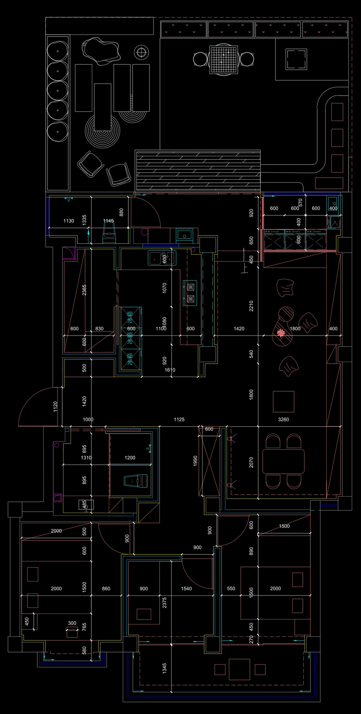

# cadspec

把中国建筑制图规范变成**能查的条文库**和**能跑的检查规则**。

施工图画完了，规范检查还得一条条翻？`cadspec` 把中国建筑制图规范整理成可检索的条文库，并将其中一部分可量化的要求转成自动检查规则。

把 DXF 图纸交给它，先检查图纸是否具备自动审查条件，再运行规则检查。对于能够从图纸中识别和计算的项目，报告会列出问题、实际情况、对应条文；支持定位的检查项还会指向具体图元。

**当前项目数据**

- **626 条**规范条文可检索
- **25 条**自动检查规则，覆盖 **18 条**条文
- 面向建筑、土木专业学习者，以及需要读取和检查 DXF 的 AI agent



## 一张图，为什么要先做体检？

这是一张真实的住宅一层平面图。墙、门窗、家具和尺寸标注都画了，但没有独立的房间名称、图名或比例文字。`cadspec doctor` 检查后发现：墙体使用双线绘制、缺少可识别的文字对象、图纸单位也没有声明。

这类问题会影响后续识别和计算。**图纸画出来了，不代表它已经具备自动检查的条件。** 所以 cadspec 把流程分成两步：先体检，再审查。

## 快速开始

**完全离线。** 条文库、检查规则、几何计算全部在本地跑——不联网、不上传图纸、
不需要 API key。图纸是别人的成果，不该为了让程序看一眼就传到谁的服务器上。

**想要图形界面（双击即用）**，仓库里带了一个 tkinter 写的 [gui.py](src/cadspec/gui.py)，
自己打包成单文件 exe 只要一行：

```bash
pip install pyinstaller
pyinstaller --noconfirm --onefile --windowed --name cadspec \
  --add-data "data;cadspec/_data" --collect-data ezdxf src/cadspec/gui.py
```

产物在 `dist/cadspec.exe`，约 45 MB（大部分是 Python 运行时和 ezdxf 的字体数据）。
**exe 不进仓库**——可执行文件不该有 commit 历史，而且 45 MB 会让 clone 变慢。

**命令行 / 接进自己的脚本**，在项目目录中安装：

```bash
pip install -e ".[dev]"
```

**第一步：图纸体检（Doctor）**

检查图纸是否具备“被自动审查”的基本条件（不阻塞流程，但能帮你排查数据失真）：

```bash
cadspec doctor 图纸.dxf
```

示例输出：

```
图纸可读性体检：1.dxf

建议  2 项（不阻塞，但会让结论失真）
  ~ [A-EMPTY-LAYER] 空图层过多
      实际情况  6/15 个图层在模型空间没有任何实体；其中 楼梯 本来应该有内容
  ~ [A-SCALE] 图上没有比例标注
      实际情况  TEXT/MTEXT/DIMENSION 里都没找到 1:x 形式的文字

通过  9 项（图形单位、文字、墙图层、墙用多线、图层体系……）

这张图能做什么
  图纸表达  能  图层、线宽、字高、比例
  几何识别  能  墙体围合、房间多边形、门窗洞口
  房间尺度  能  面积、短边、门宽分档
  尺寸标注  能  数量与比例一致性
```

**第二步：合规审查（Check）**

体检通过后，指定图面比例进行深度审查：

```bash
cadspec check 图纸.dxf --scale 100
```

示例报告：

```
── WARNING  5 条 ────────────────────────────────────────────
[R-AXIS-003] 2 个附加轴线编号写成了斜杠文本（如 "1/D"）
  依据  GB/T 50001-2017 §8.0.6《房屋建筑制图统一标准》8 定位轴线
  §8.0.6 要求“以分数形式表示”，即分子在上、分母在下的叠排真分数。
  实际  1/D、1/H
  期望  分数形式
```

`--scale` **需要明确提供。** 规范中的 2.5mm 字高、8~10mm 轴号圆等尺寸，指的是打印成品图纸上的尺寸；模型空间通常按 1:1 绘制，需要结合出图比例才能换算。例如，1:100 的图纸使用 `--scale 100`。

需要检查卧室面积等房间尺度要求时，可以使用严格级别：`--level strict`。

这类检查需要墙体以多段线表达，并在房间内标注用途。条件不足时，相应检查会降级，报告会说明原因。`--format json` 可以把结果交给其他程序或 AI agent 继续处理。

```bash
cadspec check 图纸.dxf --scale 100 --level strict --format json -o report.json
```

`examples/` 目录中提供了两份实际检查报告。

## 当前能检查什么

| 检查方向 | 示例 |
| ----- | ----- |
| 图纸表达 | 图层命名、线宽设置、文字高度、轴号方向与序号、比例标注 |
| 图形完整性 | 外轮廓是否有门洞、尺寸标注数量、已定义但没有实体的图层 |
| 房间尺度 | 卧室面积与短边、厨房面积、卫生间面积 |
| 门窗 | 洞口宽度、按通行净宽折算的门宽 |

**目前的自动规则主要覆盖能从 DXF 中识别、能用明确数值判断的要求。以下内容不在现有自动检查范围内：**

| 暂不支持自动判断 | 原因 |
| -------- | ------ |
| 定性要求 | 如天然采光、自然通风、使用便利性，无法只靠当前图形数据直接判断 |
| 依赖外部条件的要求 | 耐火等级、建筑高度、使用人数，需要额外输入 |
| 跨楼层关系 | 如卫生间是否位于其他房间上方，需要结合多层图纸分析 |
| 其他专业系统 | 给排水、电气、暖通 |
| 材料与构造 | 防火门等级、保温做法 |

626 条条文目前均可检索，自动检查由 25 条规则实现。其余条文仍可作为查询依据，但不会因此自动出现在检查报告中。

**阅读报告时，请把“未发现问题”理解为“现有规则没有发现问题”，而不是整张图纸已经全面符合规范。** 对于未覆盖的条文和需要设计判断的内容，仍需人工复核。

## 与 AI agent 配合

仓库提供了 [`skills/cadspec/SKILL.md`](skills/cadspec/SKILL.md)，说明 agent 如何调用 cadspec：

1. 先运行 `doctor`，了解图纸可检查的范围；
2. 再运行 `check`，获取规则检查结果；
3. 用 Python 完成几何和数值计算，由模型补充房间用途等语义判断；
4. 将结论对应到具体规范条文。

cadspec 是无状态的命令行工具，不需要额外部署 MCP server。把 `SKILL.md` 放进 agent 的 skills 目录，或作为指令提供给 agent，即可按文档中的流程调用。

一次端到端测试时，agent 处理一张图耗时约 33 分钟，输出了 7 条机器发现和 7 条人工补充。其中，“全图没有一扇通向室外的门”“楼梯层是空的”等问题，需要模型结合整张图理解，单靠当前规则无法判断。作为对照，规则检查本身运行约 8 秒；端到端耗时主要来自 agent 的读图和分析过程。

## 文档导航

- **规范语料库**：[docs/corpus.md](docs/corpus.md)（数据来源与录入规范）
- **设计哲学**：[docs/design.md](docs/design.md)（14 条核心技术取舍）
- **几何识别原理**：[docs/geometry.md](docs/geometry.md)
- **Agent 技能定义**：[skills/cadspec/SKILL.md](skills/cadspec/SKILL.md)
- **开发路线与后续计划**：[docs/roadmap.md](docs/roadmap.md)

## 许可与声明

代码采用 [MIT License](LICENSE) 开源，`data/` 目录见 [`data/LICENSE`](data/LICENSE)。

> **免责声明**：本仓库不包含任何标准全文、图集 PDF、扫描件或截图。条文仅保留技术判定所需的极短摘录，并逐条附带官方来源链接。正式施工图审查请以国家正式出版版本为准。

想加一条条文？只需参考 [`docs/corpus.md`](docs/corpus.md)，补齐 `clause_id` / `verbatim` / `severity_hint` / `source_url` 四个字段即可提交 PR。
