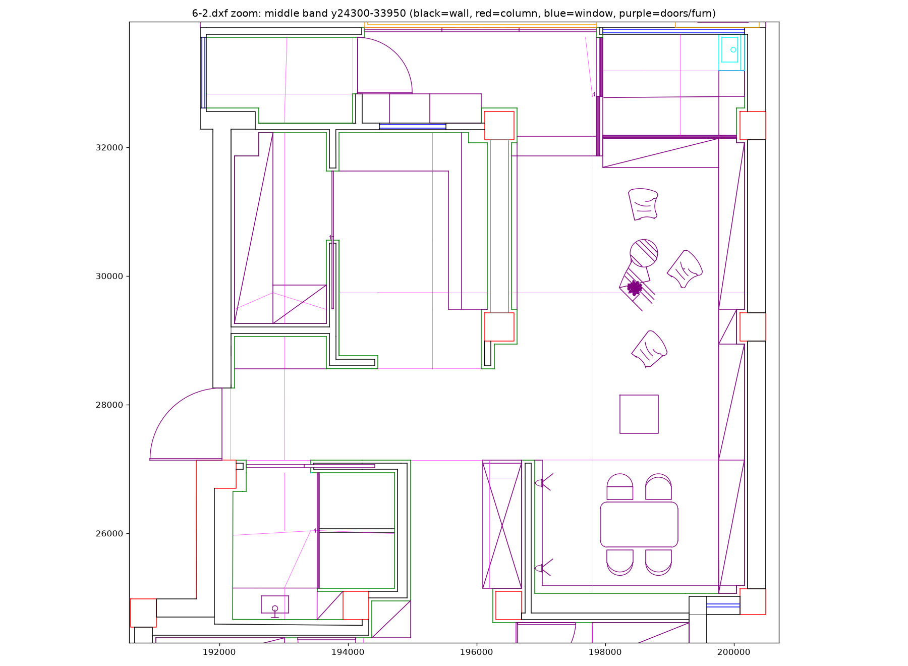

# cadspec

把中国建筑制图规范变成**能查的条文库**和**能跑的检查规则**。

丢一张 DXF 进去，它告诉你是哪几处不符合国标、依据第几条、错在哪个图元上。



**给谁用**：画建筑施工图的建筑/土木学生，和帮你画图的 AI。

**现在能做什么**：626 条条文可检索；25 条规则能自动判，覆盖 18 条条文。**其余 97% 只能查、
不能判**——定性条文（"楼梯间应能天然采光和自然通风"）、需要上下层叠加的、图上根本没画的，
机器判不了。这个比例不是没做完，是自动判定本来就只覆盖一小片。

## 快速开始

```bash
pip install -e ".[dev]"
```

先体检，再审查。体检回答「这张图能不能自动审」：

```bash
cadspec doctor 图纸.dxf
```

```
图纸可读性体检：1.dxf

建议  2 项（不阻塞，但会让结论失真）
  ~ [A-EMPTY-LAYER] 空图层过多
      实际情况  6/15 个图层在模型空间没有任何实体；其中 楼梯 本来应该有内容
  ~ [A-SCALE] 图上没有比例标注
      实际情况  TEXT/MTEXT/DIMENSION 里都没找到 1:x 形式的文字

通过  9 项（图形单位、文字、墙图层、墙用多线、图层体系……）

这张图能做什么
  图纸表达  能  图层、线宽、字高、比例
  几何识别  能  墙体围合、房间多边形、门窗洞口
  房间尺度  能  面积、短边、门宽分档
  尺寸标注  能  数量与比例一致性
```

体检通过了再审：

```bash
cadspec check 图纸.dxf --scale 100
```

```
── WARNING  5 条 ────────────────────────────────────────────
[R-AXIS-003] 2 个附加轴线编号写成了斜杠文本（如 "1/D"）
  依据  GB/T 50001-2017 §8.0.6《房屋建筑制图统一标准》8 定位轴线
  §8.0.6 要求"以分数形式表示"，即分子在上、分母在下的叠排真分数。
  实际  1/D、1/H
  期望  分数形式
```

`--scale` 不是可选项。规范里的 2.5mm 字高、8~10mm 轴号圆都是**打印成品图纸上的尺寸**，
而模型空间是 1:1 的，不给比例就没法换算。

想判「卧室够不够 5m²」这种，加 `--level strict`（前提是墙用多线画、房间里有文字标用途，
不满足会降级并在报告里说明）：

```bash
cadspec check 图纸.dxf --scale 100 --level strict --format json -o report.json
```

`examples/` 里有两份真实报告可以直接看。

## 它能判什么，判不了什么

| 能自动判 | 例子 |
|---|---|
| 图纸表达 | 图层命名、线宽是否设置、字高够不够、轴号方向与序号、有无比例标注 |
| 缺画 | 外轮廓有没有门洞、尺寸标注有几个、图层定义了却没画东西 |
| 房间尺度 | 卧室面积与短边、厨房面积、卫生间面积 |
| 门窗 | 洞口宽度、门是否够宽（按通行净宽折算） |

| 判不了 | 为什么 |
|---|---|
| 定性条文 | "应能天然采光通风""应便于使用"——没有可比较的量 |
| 需要外部输入 | 耐火等级、建筑高度、人数——图上没有 |
| 上下层关系 | 卫生间是否在别人卧室正上方，要两张图叠 |
| 系统类 | 给排水、电气、暖通 |
| 材料构造 | 防火门等级、保温做法 |

**判不了不等于合规。** 报告里没报，只说明工具没查，不说明这张图没问题。

## 给 AI 用

仓库里有 [`skills/cadspec/SKILL.md`](skills/cadspec/SKILL.md)，写清了 agent 该怎么调：
先 doctor 再 check，数由 Python 算，模型只判语义（这个房间是干什么的），每条结论落到条号。

不需要装任何 MCP server——cadspec 是无状态的纯函数，一个命令行加一段 skill 说明就够。
把 `SKILL.md` 贴进 prompt，或放进 agent 的 skills 目录即可。

实测一次：同一段 prompt 配一张图，agent 跑了 33 分钟，出了 7 条机器发现 + 7 条人工补充。
其中「全图没有一扇通向室外的门」「楼梯层是空的」两条是纯规则判不出来的，靠模型读全图。
代价是慢——规则本身跑一次 8 秒。

## 文档

| 想了解 | 看 |
|---|---|
| 数据有哪些、从哪来、怎么录入 | [docs/corpus.md](docs/corpus.md) |
| 为什么这样设计（14 条取舍） | [docs/design.md](docs/design.md) |
| 接下来做什么 | [docs/roadmap.md](docs/roadmap.md) |
| 几何识别怎么做的 | [docs/geometry.md](docs/geometry.md) |
| agent 怎么调用 | [skills/cadspec/SKILL.md](skills/cadspec/SKILL.md) |

## 和现有工具的关系

规范数据层是空的，这是本项目的位置。画图/操作层不必重造：

- [`thewisekape/autocad-mcp`](https://github.com/thewisekape/autocad-mcp)：22 类 MCP 工具，
  含 `modify` / `query`，后端可选 ezdxf 无头模式。改图交给它。
- [`kangAIGC/KnowFlow`](https://github.com/kangAIGC/KnowFlow)、
  [`WUYAC2333/building-code-rag-assistant`](https://github.com/WUYAC2333/building-code-rag-assistant)：
  面向检索的规范 RAG，形态是"问一句答一句"，不产出可执行约束。

本项目的定位是**约束层**：给这些工具提供"中国规范说什么、算不算违规"的判定依据，
`--format json` 就是为此准备的。

## 许可与来源

代码 MIT，`data/` 另见 [`data/LICENSE`](data/LICENSE)。仓库里**没有任何标准全文、
图集 PDF、扫描件或截图**——条文只做技术判定所必需的短摘录，逐条附官方来源链接。
正式审图请以正式出版版本为准。

想加一条条文？看 [`docs/corpus.md`](docs/corpus.md) 的「条文是怎么进来的」，四个字段
（`clause_id` / `verbatim` / `severity_hint` / `source_url`）填对就能提交。
